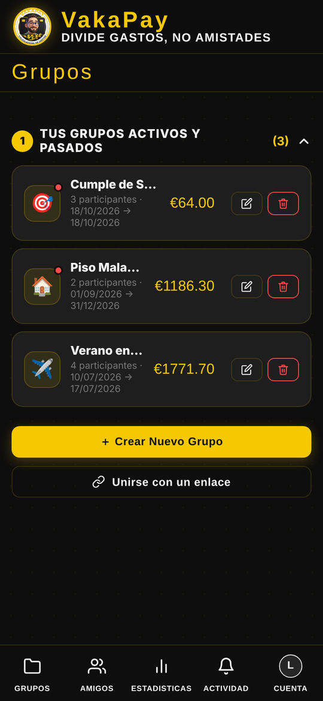
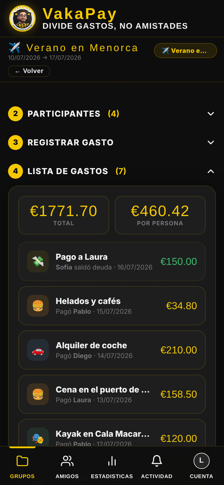
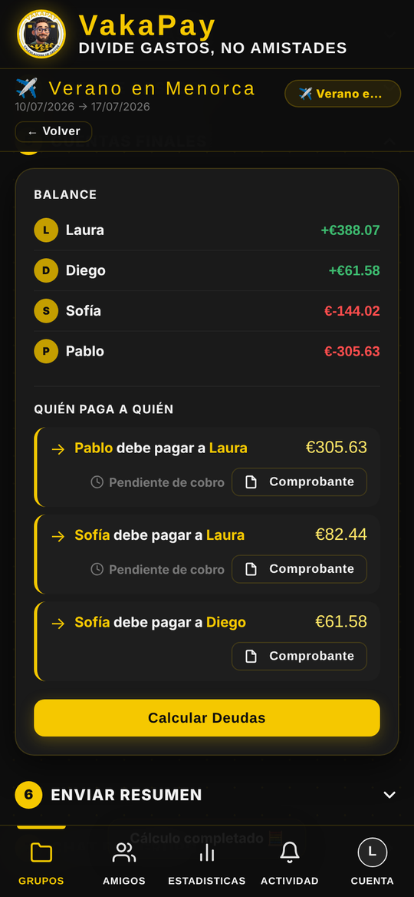
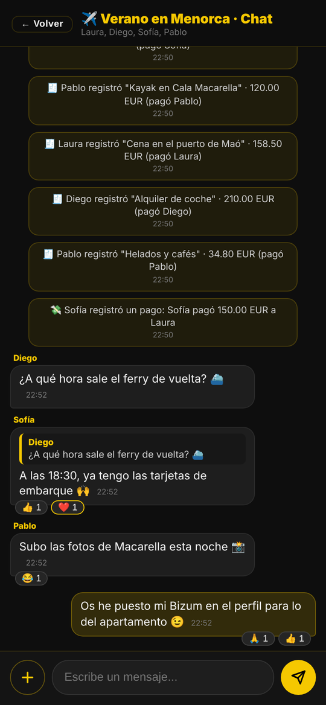
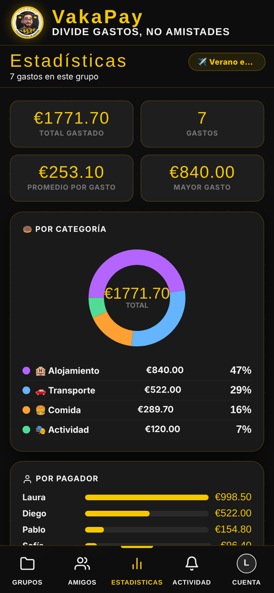
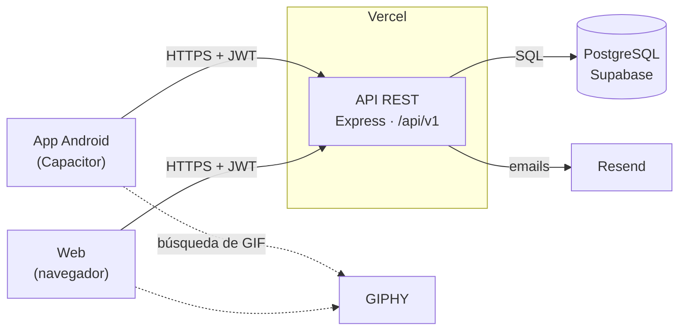

<div align="center">


# VakaPay

**Divide gastos, no amistades.**

App para repartir los gastos de viajes, pisos compartidos y planes con amigos:
cada uno apunta lo que paga, VakaPay calcula quién debe a quién y el grupo lo habla todo en su propio chat.

Web + app Android · Node.js · PostgreSQL


<sub>Vista rápida con datos de ejemplo · <a href="docs/vakapay-recorrido.mp4"><b>Ver el recorrido completo (2:20)</b></a>: registro, inicio de sesión, grupos, gastos (crear, editar y borrar), cuentas, chat, todas las pestañas y cierre de sesión.</sub>


https://github.com/user-attachments/assets/88bae315-2cab-4a46-aec1-23d706311edd


</div>

---

## Funcionalidades

**Grupos y gastos**
- Grupos por tipo (viaje, casa, pareja, otros) con fechas de inicio y fin.
- Gastos con categoría, quién pagó, para quiénes y fecha dentro del rango del grupo.
- Varias divisas (EUR, USD, GBP, ARS) con tipo de cambio y cálculo exacto en céntimos.
- Foto del ticket como comprobante, visible para todo el grupo. El importe se puede leer del ticket con OCR en el propio móvil (Tesseract.js).
- Edición con historial: cada cambio queda en la actividad del grupo.

**Cuentas claras**
- Saldo de cada participante y la lista de pagos para quedar a cero («quién paga a quién»), juntando a los mayores deudores con los mayores acreedores para que haya pocos pagos.
- Registro de pagos de deudas con comprobante.
- Datos de cobro por Bizum, IBAN o efectivo.
- Resumen en PDF con estadísticas por categoría y por pagador.

**Social**
- Invitaciones por enlace con «¿Quién eres en este grupo?», para que quien ya estaba apuntado conserve sus gastos.
- Chat por grupo con respuestas, reacciones, fotos, GIF (GIPHY) y avisos automáticos de gastos, pagos, altas y bajas.
- Amigos sincronizados con los participantes de tus grupos e importación desde la agenda del móvil.
- Actividad compartida: todos ven quién añadió, editó o borró qué.

**Cuenta y seguridad**
- Registro con teléfono validado por país (libphonenumber).
- Contraseñas con bcrypt, sesiones JWT y bloqueo temporal tras varios intentos fallidos.
- Recuperación de contraseña con código de 6 dígitos por email (Resend).
- Borrado de datos o de cuenta sin dejar deudas pendientes en grupos compartidos.
- Row Level Security activado en todas las tablas de Supabase.

## Capturas

| Grupos | Gastos | Cuentas finales | Chat | Estadísticas |
|:---:|:---:|:---:|:---:|:---:|
|  |  |  |  |  |

## Tecnologías

| Capa | Tecnología |
|---|---|
| Interfaz | HTML, CSS y JavaScript sin framework (`public/index.html`, `public/login.html`) |
| App Android | [Capacitor](https://capacitorjs.com/) 8 (Contactos, Archivos, Compartir) |
| API | Node.js 22 + Express, desplegada en Vercel |
| Base de datos | PostgreSQL en Supabase (`pg`) |
| Autenticación | JWT + bcrypt |
| Servicios | Resend (email), GIPHY (GIF), Tesseract.js (OCR), jsPDF (PDF), libphonenumber-js |

## Arquitectura



- La web y la APK comparten el mismo código: `public/` es la única fuente y `npm run sync:app` la copia a `www/`, que es lo que empaqueta Capacitor.
- El servidor crea y actualiza el esquema solo al arrancar (`src/db/database.js`), así que no hay migraciones manuales.
- La app no usa la API pública de Supabase: todo pasa por la API de Express. Por eso RLS está activado sin políticas.

## Estructura

```
src/
  index.js            Servidor Express (rutas /api/v1/*)
  db/database.js      Conexión a PostgreSQL y esquema
  middleware/auth.js  JWT
  routes/             auth, users, groups, expenses, friends, invite, chat, activity, ocr
  utils/              actividad, contactos, teléfonos, borrado de cuenta
public/               Interfaz web (fuente única)
www/                  Copia de public/ para la APK (generada)
android/              Proyecto Android de Capacitor
scripts/sync-www.js   Copia public/ → www/
docs/                 Demo y capturas
```

## Puesta en marcha

Requisitos: Node.js 22 y una base de datos PostgreSQL (local o Supabase).

```bash
npm install
cp .env.example .env   # y rellena las variables
npm run dev            # API en http://localhost:3000
```

La interfaz llama a la API desplegada (`https://vakapay-app.vercel.app`). Para probar con tu servidor local, cambia esa dirección en `public/index.html` (`API_BASE`) y en `public/vakapay_data_service_v2.js`.

### Variables de entorno

| Variable | Obligatoria | Para qué |
|---|:---:|---|
| `DATABASE_URL` | ✔ | Conexión a PostgreSQL |
| `JWT_SECRET` | ✔ | Firma de las sesiones |
| `RESEND_API_KEY` | | Emails de recuperación de contraseña |
| `GIPHY_API_KEY` | | Buscador de GIF del chat |
| `ANTHROPIC_API_KEY` | | OCR de tickets en el servidor (opcional; por defecto se lee en el móvil) |

### App Android

```bash
npm run sync:app        # public/ → www/
npx cap sync android    # copia www/ y plugins al proyecto Android
npx cap open android    # abre Android Studio para compilar la APK
```

## Hoja de ruta

- Verificación del email al registrarse (dominio propio en Resend).
- Política de privacidad y formulario de seguridad de datos de Google Play.
- App Links para que el enlace de invitación abra directamente la app.
- Notificaciones push.
- Inicio de sesión con Google.

## Autor

- Francisco Rodriguez: idea, diseño y desarrollo de VakaPay.

- GitHub: [Franiv1982](https://github.com/Franiv1982)
